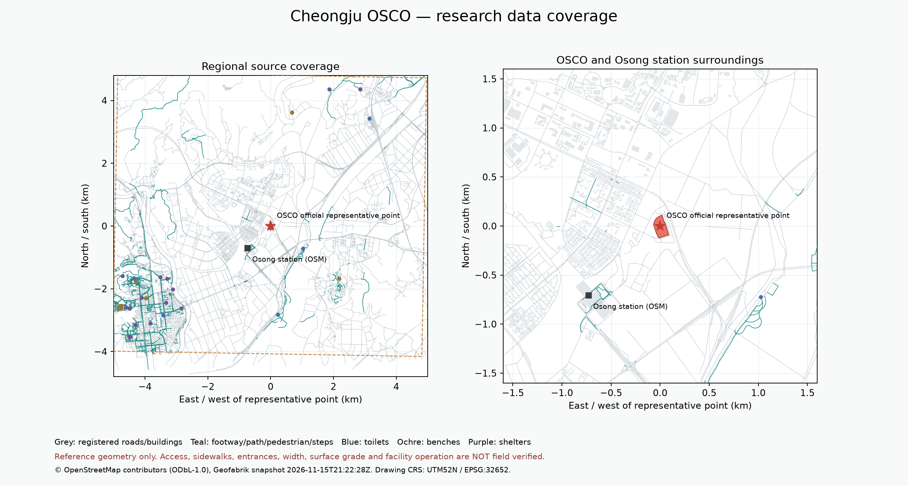

# 청주오스코 주변 자료조사

사용자 지시에 따라 우송대학교 조사·구현 계획을 보류하고 **청주오스코 주변의 자료조사만** 진행했다. 앱 자료·엔진·화면·Vercel·APK는 변경하지 않았다. 조사 브랜치는 `research/cheongju-osco-2026-11-16`이다.

조사는 2026-11-16 KST에 착수했으며 실제 원본 수집은 **11월16일23:59부터 11월17일00:49까지** 이어졌다. 개별 UTC/KST 시각은 [요청 목록](sources.csv)과 `raw/*/request.json`에 고정했다. 파일명 날짜를 원본의 자료 기준일로 사용하지 않는다.

**이 자료는 온라인 등록·문서 근거다. 현장 통행, 출입문·승강기 운영, GPS 정확도, 보도 유효폭·노면 경사는 확인하지 않았다. 새 경사값 승격과 활성 경로망 변경은 모두0건이다.**

## 범위와 확보 결과

행사장 주소는 **충청북도 청주시 흥덕구 오송읍 오송생명로250**이다. 공식 갤러리 페이지의 지도 대표점은 위도36.6267203·경도127.335363이며, **보행 출입문을 실측한 점은 아니다**. 이 점은 OSM의 `way/1423171859` 청주오스코 건물 내부에 들어간다. 주소·건물 대조를 위치 정확도 검증으로 확대하지 않는다.

광역 조사 상자는 `[127.28,36.59,127.39,36.67]`(경도·위도), 약9.8×8.9km다. 오송역·행사장 핵심 비교는 `[127.315,36.61,127.35,36.64]`로 좁혔다. 광역 상자에는 **세종 조치원 등 청주시 밖도 포함**되지만 청주시 GIS는 청주시 관할 자료다. 서로 다른 행정 범위의 건수를 그대로 비교하지 않는다. [범위 정의](scope.json).

| 확보물 | 실제 확보량 | 구분·한계 |
| --- | ---: | --- |
| 원본 요청·응답 |184회 요청,181개 완결 응답 SHA256 대조,약426MB 보존|오류 응답도 보존. HTTP200이나 파일 크기만으로 데이터 취득 성공이라 하지 않음|
| 날짜 고정 OSM PBF |291,897,143bytes|Geofabrik/OSM 기준2026-11-15T21:22:28Z, MD5·SHA256 확인|
| 주변 OSM 추출 |상자 안 노드89,279개·way13,302개·relation165개|way 참조 복원용 범위 밖 노드6,635개 별도 포함|
| OSM 표시 검토층 |도로way6,644·건물4,690·접근지물1,764·교통446·시설2,357·녹지/물4,425|층끼리 같은 객체가 겹침. 실제 시설 수나 검증된 보행 구간 수와 다름|
| OSM 독립 대조 |최신 OSM API와 공통객체14,847개 일치|같은 버전의 태그·좌표·참조 불일치0. 현장 정확도 증명은 아님|
| 버스 관계·문맥 |32개 관계·way2,155개·노드14,563개 복원|원본 순서와 역할 보존. 최신 시간표·저상차량·환승 검증은 아님|
| 청주시 시설 도형 |19종,유효 도형5,462개|EPSG:5186 명시 원본을 별도 보존. 이용조건·조사 정확도 미확인으로 연구용 분리|
| 공식 행사장 문서 |34쪽 시설 가이드·전시장 배치/소화설비 도면·운영규정·주차 도면 등|내부 도면은 GPS에 정합된 지도나 현재 운영 확인이 아님|
| BF 인증 |본인증8244호·우수,예비6908호 별도|공식 상세 HTML과 XLS 대조. 외부 접근로 인증으로 확대하지 않음|
| 공개 표고 |Copernicus GLO-30 GeoTIFF49,583,060bytes·주변288×396픽셀 절취|30m급 **DSM**, 보도 노면 실측 아님. 1m/5m DEM·1:1,000 DXF는 미확보|

[전체 요청 집계](collection-summary.json) · [출처 JSON](sources.json) · [OSM 추출](osm-extraction-results.json) · [독립 대조](osm-independent-validation.json) · [공식 근거](primary-evidence.json)

이 그림의 청록색은 등록 footway/path/pedestrian/steps이며, 통행 가능·휠체어 적격 판정이 아니다. 회색 도로를 보도로 간주하지 않는다. 원본 좌표를 옮기거나 없는 연결선을 만들지 않았다.

## 지자체 원본: 도로면·보행 안전시설

[청주시 공개 지도](https://www.cjtgis.go.kr/map/mapMain.do)의 익명 화면과 공개 클라이언트가 사용하는 **읽기 전용 WFS**에서 확보했다. 로그인·관리·시설 수정 API는 사용하지 않았다. 일반 익명 세션과 사이트의 정상 CSRF 절차로 공개 집계도 조회했다. 타사 지도 SDK·네이버 API·타일은 호출하지 않았다.

응답 CRS는 `urn:ogc:def:crs:EPSG::5186`이며, 원본을 유지한 채 별도 연구 사본만 EPSG:4326으로 변환했다. 수학적 좌표 왕복 오차 검사는 **측량 정확도나 현장 오차가1cm라는 뜻이 아니다**. 수직 기준·원본 측량 축척·위치 정확도는 확인하지 못했다. `REG_YMD`, `UPT_YMD`, `ESB_YMD`는 원문 등록/수정/설치 필드이며 자료 전체의 조사 기준일로 바꾸지 않았다.

| 공개 레이어 | 유효 도형 수 | 공개 레이어 | 유효 도형 수 |
| --- | ---: | --- | ---: |
| 도로면 |466|횡단보도|1,092|
| 점자블럭 |1,241|음향신호기|294|
| 보행자버튼 |44|보행신호 음성안내 보조장치|17|
| 바닥보행신호등 |4|보행용조명|610|
| 횡단보도조명 |137|승강장|263|
| 교통섬 |90|방호울타리|773|
| 과속방지턱 |339|입체횡단시설|3|
| 자전거전용도로 |59|노인보호구역|17|
| 어린이보호구역 |13|장애인보호구역·공영주차장|각0건 응답|

건수는 **등록 도형 단위**이며 실제 시설 개수와 같다고 단정하지 않는다. 도로면·자전거도로·횡단보도 조명은 핵심 범위, 나머지는 광역 범위 및 복구 타일을 사용했으므로 모든 층의 조사 면적이 같지 않다. 0건 응답도 물리적으로 시설이 없다는 뜻이 아니다. 승강장 도형을 실시간 노선·저상차량·TAGO 정류장 ID로 자동 치환하지 않았다.

- 점자블록 광역 조회는 원본의 **닫히지 않은 LinearRing** 때문에 실패했다. 작은 범위로 나눠 정상 도형을 확보하고, 추가12회 조회 후 끝내 읽히지 않은 북동쪽 작은 영역1곳을 **결측**으로 남겼다. [복구 범위·실패 기록](tactile-recovery-results.json). 원본을 임의로 닫거나 그 영역을0건으로 채우지 않았다.
- HTTP200으로 내려온 것 중 별도로 비유효 도형22개를 보류했다. 삭제·도형 보정 대신 원본과 ID를 유지했다.
- `GT_A112_P` 보행등보조장치는 클라이언트 목록에 있으나 서버가 `Feature type unknown`을 반환했다. 미확보로 기록했다.
- 겹치는 조회의807개 차이는 실제 geometry나 등록 속성이 아닌 `GEOM` 속성의 Java 바이트배열 식별 문자열(`[B@...`)이었다. 이 일시적 문자열만 구분하고 실제 geometry·다른 속성은 그대로 대조했다. [진단](municipal-overlap-diagnostics.json).
- 공개 집계의 오송읍 등록값은 점자블록896,횡단보도759,음향신호기284 등이다. **오송읍 전체 집계**를 광역 상자·핵심 범위 또는 개별 정류장 수와 혼합하지 않는다. [집계 원문](municipal-statistics-results.json).

실제 도형·원본 속성은 로컬 `municipal-derived/`와 `raw/`에 보존하고, 재이용 조건이 확인되기 전 공개 앱·경로망으로 이관하지 않았다. [레이어별 범위·해시·보류](municipal-geometry-results.json) · [공개 레이어 명세](municipal-public-layer-definitions.json).

같은 핵심 사각형에서 OSM 횡단 관련 point1개·way9개와 지자체 도형을 위치 대조했다. 서로 객체 단위가 다르므로 건수 차이를 완성도 비율로 만들지 않았다. 가까운 위치도 같은 시설이라는 확정·턱/폭 검증이 아니며, 좌표 수정·자동 병합·가짜 횡단 연결은0건이다. [범위를 바로잡은 최종 비교](osm-municipal-position-review.json). 첫 광역 비교는 세종/조치원까지 혼합한 잠정본으로 별도 보존하고 최종 판정에서 제외했다.

## 행사장·철도 접근 근거와 상충 사항

1. [BF 공식 본인증 상세](https://www.koddi.or.kr/bf/state/resultDataView.do?resultSeq=22241)에 **충북청주전시관·본·우수·8244호·인증일2026-07-06·등록 만료일2036-07-05**가 표시된다. 신청기관은 충북개발공사이며 면적39,725.19㎡는 운영사 개요의39,725㎡와 대응한다. 건립기관 자료의 오송읍 궁평리·만수리 위치, 사업명과 함께 대조했다. 예비인증6908호(2022-04-15)를 현재 본인증 대신 쓰지 않았다. **인증의 외부 접근로 포함 여부·당일 시설 운영 상태는 확인하지 않았다.**
2. [공식 시설 가이드](https://d2u77gqg41v474.cloudfront.net/app/uploads/2026/04/01094035/%EC%8B%9C%EC%84%A4%EA%B0%80%EC%9D%B4%EB%93%9C_%EC%B2%AD%EC%A3%BC%EC%98%A4%EC%8A%A4%EC%BD%94.pdf)는34쪽이다. PDF 생성/수정은2026-03-24이나 실측일이 아니다. 5쪽의 의무지원실,6쪽 등의 승강기·장애인화장실·수유실을 확인했다. 자료 자체가 실제 시설과 다를 수 있다고 명시한다. 도면에 없는 GPS 좌표·엘리베이터 운행 층·실시간 고장을 추측하지 않았다.
3. [운영사 주차 도면](https://osco.or.kr/facilities_guide/parking/)과 갤러리 안내는 **총991대(234+80+380+202+95)**이며 장애인50대·전기차52대는 총수에 포함한다고 도면에 표기한다. 반면 시설 PDF는1,114대다. **123대 차이를 보존**했으며 당일 가용면수·장애인 구역까지의 무단차 접근은 미확인이다.
4. 갤러리는649㎡,시설 가이드는 미술관823㎡로 표기한다. 사용면적/총면적 등 정의 차이 가능성이 있어 하나로 합치지 않았다. 운영시간과 월요일 휴관 안내도 **무더위쉼터의 개방 조건으로 대체하지 않았다**.
5. [운영사 교통안내](https://osco.or.kr/traffic/traffic_guidance/)는 오송역8번출구·도보10분,53/518/521/535/B3 등의 정적 안내를 제공한다. [공식 갤러리 안내](https://www.cbartgallery-osco.com/cbart-osco/contents.do?key=851)는53/502/511/535/B3와 정류장 하차 후3~5분을 제시한다. 최신 완전 노선망·개별 운행편·저상버스 보장을 확인한 것이 아니다. **OSM의 ‘오송역8’ 버스정류장과 철도역8번출구는 별개**이며 자동 대응시키지 않았다.
6. 전시장 근린생활시설 모집 공고(2026-07-27,마감)는 계획된 카페·음식점 공간이 현재 실제 영업 중이라는 증거가 아니다. 오스코 대표043-230-4000,주차문의043-230-4009는 공식 안내의 연락처로만 기록했으며 연락을 보내지 않았다.

[공식 근거 구조화](primary-evidence.json) · [BF XLS 원문 전사](bf-excel-rows.json) · [시설 PDF 페이지 색인](facility-pdf-page-index.json)

## 표고·경사와 OSM의 결측

OSM 도로6,644개 중 원문 `width`는11개,`wheelchair`는2개,`incline`은46개다. 경사 원문은 `up`21·`down`23·`0%`1·`-0%`1로, **수치 경사 자료가 사실상 비어 있다**. width가 있어도 보도 유효폭 실측이라고 단정하지 않는다. 별도의 footway와 `footway=sidewalk`도 있으므로 `sidewalk` 키2건만으로 보도 개수를 계산하지 않는다. [태그·도형 점검](geometry-and-completeness-review.json).

Copernicus 절취본은 원 타일의 픽셀과 완전히 일치하고 재표본화하지 않았다. 수평 EPSG:4326,제품 문서의 수직 EGM2008(EPSG:3855)·미터를 구분했다. 타일 자체 CRS에는 수직 기준이 함께 인코딩돼 있지 않다. 제품의 주 취득기간2011~2015와 본 타일의 촬영일은 다르며 개별 타일 촬영일은 미확인이다. 건물·수목을 포함하는 DSM이므로 이를 보도 노면 경사로 바꾸지 않았다. [표고 메타데이터](dem-extraction-results.json) · [원본 픽셀 대조](dem-validation.json).

국토정보플랫폼·정밀지도/표고 카탈로그의 실제 요청은 연결 실패가 많았다. 브라우저/검색 추출로 메타데이터를 보완했으나 **1:1,000 DXF/NGI/SHP,등고선·표고점,지역1m/5m DEM 원본을 다운로드했다고 하지 않는다**. 규정에1m/5m 격자가 있다는 사실도 이 지역의 제공 여부나 확보를 뜻하지 않는다. [별도 웹 추출 근거](web-evidence/)는 원본 HTTP·원본 자료와 구별했다.

## 쉼터·화장실 등 2차 자료

공식 전국 화장실 CSV·무더위쉼터 API·청주 BIS/TAGO 원본 경로는 연결 실패·인증 조건으로 이번에 전체 원본을 확보하지 못했다. 최신 화장실 표준 안내는2025년2월 좌표 제공 중단을 설명하므로, 2차 사이트 지도 좌표를 공식 좌표로 간주하지 않았다.

- 공개 쉼터 가공 CSV는62,694행을 실제 확보했고,대표점 반경5km의109개 후보를 따로 보관했다. 원본 기관 조회는 미성공이며,가공 사이트의 총건수62,704와 CSV62,694 차이·기준일보다 앞선 수집일·이용조건 미확인 등을 기록했다. 빈 주말/야간 값은‘운영 안 함’으로 바꾸지 않았다.
- 화장실 공개 목록5쪽에서 흥덕구129개 목록 ID를 확인했으나 표시 좌표는64개에만 있었다. 반경5km 표시점14개를 따로 보관했다. 좌표가 없는 나머지를 지오코딩으로 채우지 않았다.
- 다른 쉼터 사이트의 오송읍11개 표시점과 이름/주소가 대응되는 후보를 비교했지만,양쪽 위치가 거의 같아도 **동일 원천의 복제일 수 있으므로 독립 현장 검증으로 인정하지 않았다**.
- 오송역 현장 사진·안내를 주장하는 주민 아카이브도 원문을 보존했으나,그 사이트의 조사일을 본 프로젝트의 현장 조사일로 가져오지 않았다. 철도 공식 편의 API의 명세 확보를 실제 오송역 시설 데이터 확보로 계산하지 않았다.

[2차 자료 검토](secondary-facilities-review.json). 재이용·좌표 원천이 미확인인 전체 가공 행은 로컬 `secondary-derived/`에만 보존하고 Git/앱에 자동 반영하지 않는다.

## 보존·재현과 다음 조사

- `raw/*/request.json`: 요청 URL·시각·응답 코드·크기·SHA256. `response.bin` 원문은 로컬에 그대로 보존하며 큰 본문은 Git 제외다. 원본 없는 환경에서는 해시 목록만으로 확보 완료라 하지 않는다.
- `documents/`: 원본 PDF·PNG·XLS·HWPX12개를 읽을 수 있는 파일명으로 복사한 로컬 사본. [이름·원본 ID·해시](documents-manifest.json)를 대조했으며 원문 변경은 없다. 큰 파일·별도 이용조건이 있는 원본 사본은 Git 제외다.
- `derived/`: ODbL OSM 지역 객체·표시층·버스 관계와 Copernicus 절취본. 원본·라이선스·필드 의미를 함께 제공한다. 버스 문맥v1은 초기 지역범위의 완결 플래그가 남아 있어v2에서 원래 플래그와 현재 복원 완결 여부를 구분했고,v1을 보존했다.
- `municipal-derived/`, `secondary-derived/`: 이용조건/불확실성이 남은 별도 로컬 연구 자료. 활성 지도·경로 그래프로 사용하지 않았다.
- `collect.py`,`plans/`: 일반 공개 요청 재현. `collect_public_statistics.py`: 정상 익명 세션의 공개 집계. `recover_tactile_extents.py`: 결측을 보존하는 범위 분할. 기존 출력이 있으면 덮어쓰지 않으므로 새 조사 디렉터리에서 실행한다.
- `extract_osm.py`,`validate_osm.py`,`extract_bus_context.py`,`extract_municipal.py`,`review_secondary.py`,`verify_dem.py`,`plot_coverage.py`: 원본 처리·대조. 실제 패키지 버전은 `requirements-tools.txt`다. 살아 있는 서비스는 재조회 시 내용이 달라질 수 있으므로 이번 원본과 새 응답을 분리해야 한다.

남은 우선순위는 ①지자체 도형의 재이용 조건·측량 축척·갱신/필드 정의 확인,②오송역8번출구부터 실제 행사장 출입문까지의 무단차 동선·승강기·신호·턱·유효폭 현장 점검,③공식 쉼터/화장실 원본과 운영 조건 확보,④지역 정밀지도·더 세밀한 DEM 원본 확보다. 이를 확인한 뒤 앱 표시용 근거와 경로용 자료를 구분해 이관해야 한다. 아직 앱 반영·Vercel 배포·APK 재생성 단계로 넘어가지 않았다.

OSM: © OpenStreetMap contributors, [ODbL-1.0](https://www.openstreetmap.org/copyright). Copernicus 절취본: Produced using Copernicus WorldDEM-30 © DLR e.V.2010-2014 and © Airbus Defence and Space GmbH2014-2018 provided under COPERNICUS by the European Union and ESA; all rights reserved. The organisations in charge of the Copernicus programme by law or by delegation do not incur any liability for any use of the Copernicus WorldDEM-30. [적용 라이선스](derived/LICENSE-COPDEM-GLO30F.txt).
